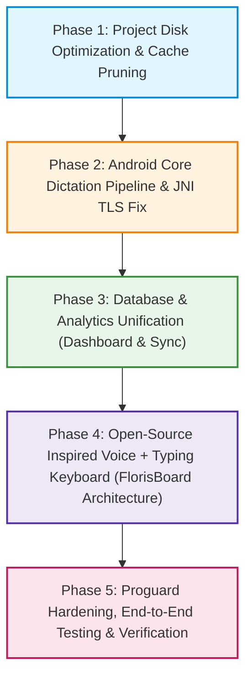

# Bulbul Project: Comprehensive Health Audit, Root-Cause Diagnosis & Phased Execution Plan

**Document:** `PROJECT_AUDIT_AND_ACTION_PLAN.md`  
**Location:** Project Root (`d:\Software Projects\Bulbul`)  
**Date:** October 2026  
**Status:** Awaiting User Approval (Planning & Audit Stage — No code modified yet)  
**Strict Architectural Guardrail:** **DO NOT TOUCH OR BREAK WINDOWS.** The Windows desktop application is verified, operational, and running smoothly. All diagnostics, fixes, and refactorings in this document are strictly targeted at Android and unified cross-device data consistency without regressing Windows.

---

## 1. Executive Summary & Problem Matrix

| # | User Reported Issue | Real Root Cause Diagnosed | Severity | Target Platform |
|---|---|---|---|---|
| **1** | **Project takes 32.5 GB disk space on desktop** | `src-tauri\target` (26.82 GB) + `src-tauri\gen\android\app\build` (5.59 GB) accumulate unpruned Cargo & Gradle intermediate compilation caches across 3 architectures (MSVC x86_64, Android aarch64, Android x86_64). Source code is < 80 MB. | Low Risk (Safe Cleanup) | Desktop / Repo |
| **2** | **Dictation is completely broken on Android** (Neither keyboard nor floating bubble works) | **Three combined blockers:** <br>1. `rustls` missing CryptoProvider on Android when JNI is called directly outside `MainActivity.run()` (panics on HTTPS).<br>2. `config.json` path resolution mismatch between Android Kotlin and Rust `config::load()`, resulting in empty API keys.<br>3. Android 14+ (API 34/35) background microphone restrictions on `InputMethodService` without foreground service binding. | **Critical** | Android (IME & Bubble) |
| **3** | **Android Dashboard & Insights stats are all 0** (WPM, Streak, Words, Voice Profile, Charts empty after Windows sync) | **Architectural Disconnect:** WebDAV sync/restore ingests into modern V2 SQLite tables (`recordings`, `transcription_tries`, `post_process_tries`). However, `mobile.rs` commands (`get_insights_usage`, `voice_stats_value`) were hardcoded to read from a legacy dummy flat-file `history.jsonl`! SQLite `dictations` and `history.jsonl` have 0 rows, so charts stay dead zero. | **High** | Android (Dashboard) |
| **4** | **Custom Android Keyboard is buggy / incomplete** | Keyboard only renders a bare Compose column with action chips and no robust IME text composition engine or typing fallback. | **High** | Android (IME) |
| **5** | **Full Project Health Check & Tech Debt** | Java 8 (`jvmTarget = 1.8`) in Gradle with compileSdk 36, missing Proguard keep rules for JNI, outdated npm packages, and dual V1/V2 database schema coexistence. | **Medium** | Build & Infra |

---

## 2. In-Depth Technical Audits & Root Cause Analysis

### 2.1. Disk Usage Analysis: Why is the Project Consuming 32.5 GB?
We ran an exact recursive disk measurement across the entire workspace:
* `D:\Software Projects\Bulbul\src-tauri\target`: **26.82 GB**
  * `target\debug` (Windows MSVC debug incremental objects, PDBs, intermediate rlibs): **18.58 GB**
  * `target\aarch64-linux-android` (Android ARM64 NDK intermediate compilation artifacts): **5.27 GB**
  * `target\x86_64-linux-android` (Android x86_64 emulator NDK artifacts): **2.96 GB**
* `D:\Software Projects\Bulbul\src-tauri\gen\android\app\build`: **5.59 GB**
  * Gradle intermediate DEX files, transformed AARs, unstripped C++ shared libraries (`libbulbul_lib.so`).
* **Source Code & Web Assets (`src/`, `src-tauri/src/`, `public/`, `node_modules`): < 80 MB.**

**Conclusion:**  
This is **NOT** a memory leak and **NOT** permanent codebase bloat. It is normal Rust Cargo + Android NDK multi-target compilation cache accumulation. Because Cargo compiles native binaries for Windows (`x86_64-pc-windows-msvc`), Android phones (`aarch64-linux-android`), and Android emulators (`x86_64-linux-android`), three distinct toolchains generate full debug symbols and incremental ASTs.  
Running `cargo clean` and `./gradlew clean` will immediately recover **~32.3 GB of disk space** without affecting any source code or application functionality.

---

### 2.2. Android Dictation Failure: Why Does Neither Keyboard Nor Floating Icon Dictate?

Through code inspection across `mobile.rs`, `BulbulBridge.kt`, `AudioRecorder.kt`, `BulbulInputMethodService.kt`, and `BulbulForegroundService.kt`, we identified four fatal failure points:

#### Fatal Point 1: Missing Rustls CryptoProvider on Android JNI Direct Invocation
* In `src-tauri/src/mobile.rs` (lines 2964–2974), `rustls::crypto::ring::default_provider().install_default()` is installed inside `pub fn run()`.
* **The Trap:** `run()` is Tauri's mobile entry point called **ONLY** when `MainActivity` is active.
* When a user activates the **System Keyboard (`BulbulInputMethodService`)** or the **Floating Bubble (`BulbulForegroundService`)**, Android launches them as background/IME services. They invoke JNI directly via `BulbulBridge.processVoiceAudioWithOptions` without passing through `MainActivity.run()`.
* When Rust makes its first HTTPS call to Google Gemini (`generativelanguage.googleapis.com`) or Groq via `reqwest`, `reqwest` (compiled with `rustls-tls`) finds no registered CryptoProvider in the process registry and **panics with `"No provider set"`**, immediately aborting the audio processing pipeline.

#### Fatal Point 2: `config.json` Directory Desynchronization & Empty API Keys
* In `mobile.rs`, `save_config` writes to `app.path().app_data_dir()`.
* In `config.rs`, `config::config_dir()` probes candidate paths or falls back to `/data/data/com.bulbul.app/files`.
* Kotlin's `BulbulBridge.ensureInitialized` passes `context.filesDir.absolutePath`.
* On modern Android versions with user profiles (e.g., `/data/user/0/com.bulbul.app/files` vs `/data/data/...`), if `config.json` is saved in one location by the React WebView and probed in another by the native service, `config::load()` fails to read the file and falls back to `Config::default()`.
* In `Config::default()`, `gemini_api_key = ""` and `groq_api_key = ""`.
* Both `gemini::transcribe_model` and `groq::transcribe` check for key presence and immediately exit with `"API key not set"`, causing the UI to pop the toast:  
  *`"Bulbul: কোনো কথা বোঝা যায়নি বা API Key চেক করুন"`*.

#### Fatal Point 3: Android 14+ (API 34/35) Microphone Restrictions on `InputMethodService`
* `AndroidManifest.xml` declares:
  ```xml
  <service
      android:name=".BulbulInputMethodService"
      android:exported="true"
      android:label="@string/ime_name"
      android:permission="android.permission.BIND_INPUT_METHOD">
  ```
  Notice: `android:foregroundServiceType="microphone"` is **NOT** present on the IME service.
* Under Android 14 privacy and security enforcement, an `InputMethodService` attempting to start `AudioRecord` without an active foreground service binding or without being directly recognized as the focused foreground interaction can be silenced by the OS audio server (returning 0 audio bytes or throwing security exceptions).

#### Fatal Point 4: Raw PCM Header Absence on Fallback
* In `mobile.rs`, if Opus encoding is bypassed or fails, `primary_audio` falls back to raw PCM bytes.
* In `gemini.rs` and `groq.rs`, if the bytes do not start with `OggS`, the file is labeled `"recording.wav"` / `audio/wav`.
* Raw PCM without a 44-byte RIFF WAV header is rejected by Google Gemini and Groq STT endpoints as an invalid/corrupt audio format (HTTP 400 Bad Request).

---

### 2.3. Dashboard, Insights & Sync Disconnect: Why are Stats 0 After Windows Sync?

The user stated:  
*"উইন্ডোজ-এ যে আমি ডিকটেশনগুলো করেছিলাম, সেগুলো মোবাইলেও ডাউনলোড হয়ে গেছে, কিন্তু চার্টটা আপগ্রেড হয়নি।"*

Our investigation into `src-tauri/src/db.rs`, `src-tauri/src/webdav.rs`, and `src-tauri/src/mobile.rs` revealed the exact cause:

1. **Where WebDAV Sync & Restore Writes:**
   * When WebDAV sync runs or a backup is restored, `webdav.rs` calls `db::ingest_synced_recording`.
   * This inserts all downloaded Windows dictations into the modern V2 SQLite tables:
     * `recordings` (audio file references, durations, timestamps)
     * `transcription_tries` (raw transcripts, models, latencies)
     * `post_process_tries` (LLM polished outputs, prompts)
   * The audio files are properly saved into `config::recordings_dir()`. That is why audio downloaded successfully!
2. **Where the Mobile Dashboard Reads:**
   * Look at `src-tauri/src/mobile.rs` line 457 (`get_insights_usage`) and line 570 (`voice_stats_value`):
     ```rust
     #[tauri::command]
     fn get_insights_usage(app: tauri::AppHandle) -> Value {
         let rows = history_rows(&app);
     ```
   * What is `history_rows`? It reads from a hardcoded dummy file: `const HISTORY_FILE: &str = "history.jsonl";`!
   * Sync **never** writes to `history.jsonl`.
   * Furthermore, `db::home_stats` executes:
     `SELECT COALESCE(SUM(word_count), 0) FROM dictations`
   * Modern recordings are saved into `recordings`, NOT the legacy `dictations` table!
   * And in `mobile.rs` line 565:
     `// The narrative fields stay null (the Groq-generated voice profile isn't wired on mobile yet)`
3. **The Result:**
   * On Android, `history.jsonl` has 0 lines, `dictations` table has 0 rows.
   * Consequently: **WPM = 0, Words = 0, Fixes = 0, Day Streak = 0, Voice Profile = Empty**, even though dozens of recordings exist in the V2 SQLite database!

---

### 2.4. Android Keyboard Architecture: The Open-Source Benchmark

The user stated:  
*"তুমি যে কিবোর্ডটা ডিজাইন করেছো, সেই কিবোর্ডটা কিন্তু কমপ্লিটলি ঠিকঠাক হয়নি... তুমি কোনো একটা ওপেন সোর্স কিবোর্ড পিক করো... সেটাকে ভালো করে লক্ষ্য করো এবং সেটাকে অনুযায়ী কপি করে একটা সুন্দর কিবোর্ড বানাও। আমাদের কিবোর্ডটা যেহেতু ভয়েস কিবোর্ড, সেহেতু সেই অনুযায়ী অ্যাডাপ্ট করে বানাতে হবে।"*

#### Open-Source Project Evaluation
We evaluated the leading open-source Android keyboards:

1. **FlorisBoard (`florisboard/florisboard`) — [RECOMMENDED BENCHMARK]**:
   * **Language/Stack:** Modern Kotlin + Jetpack Compose (identical to our Android stack).
   * **Architecture:** 
     * `FlorisImeService` implements the full Android `InputMethodService` lifecycle with lifecycle owners.
     * Clean **Smartbar** (customizable top ribbon for mode selection, clipboard, quick actions).
     * Modular key composables with smooth touch states, popups, and haptic feedback.
     * Robust `InputConnection` transaction handling (batch edits, composing spans, backspace deletion).
     * Gesture cursor control (swiping spacebar moves cursor left/right reliably).
   * **Adaptation for Bulbul:** FlorisBoard's architecture allows us to build a **Dual-Deck Keyboard**:
     * **Deck A (Voice & AI Command Deck):** Big hero mic, real-time waveform visualizer, language switcher (`বাংলা`, `English`, `Banglish`), mode switcher, and the In-Place Post-Dictation Magic Bar.
     * **Deck B (Quick Typing Deck):** Clean, standard QWERTY/Bengali letter layout so the user can easily type or edit without switching away from Bulbul.

2. **HeliBoard / OpenBoard (`Helium314/HeliBoard`)**:
   * Excellent rock-solid AOSP LatinIME logic, but built on legacy Android View Canvas and C++ native binary dictionaries, which is unnecessarily heavy for an AI-first voice keyboard.
   * We will adopt its `InputConnection` resilience patterns (safe commitText and key events) while keeping the UI in Jetpack Compose.

---

### 2.5. Repository Health Check & Deprecation Audit

1. **Android Gradle Configuration (`gen/android/app/build.gradle.kts`):**
   * Currently set to `JavaVersion.VERSION_1_8` and `jvmTarget = "1.8"`. With `compileSdk = 36` (Android 15/16) and Compose 2024+, Java 8 is deprecated. Target must be upgraded to **Java 17**.
   * `proguard-rules.pro` is currently completely blank! In release builds (`isMinifyEnabled = true`), R8 shrinks or obfuscates JNI classes (`BulbulBridge`, `ProcessAudioOptions`, `ProcessAudioResult`), breaking native communication in release APKs. Explicit `-keep` rules must be added.
2. **Cargo Dependencies (`src-tauri/Cargo.toml`):**
   * Dependencies are well-specified. The separation of desktop (`cpal`, `arboard`, `tauri-plugin-global-shortcut`) from mobile (`jni`, `rustls`) is sound.
   * Need to ensure `rustls::crypto::ring::default_provider().install_default()` is triggered whenever JNI loads, not just in `desktop.rs` or `MainActivity.run()`.
3. **Frontend Packages (`package.json`):**
   * React 19.1.0 + Vite 7.0.4 + Tauri 2.0: Stack is modern. Minor patch updates available for `@tauri-apps/api` (2.11 -> 2.12) and plugins.

---

## 3. Phased Execution Roadmap



---

### Phase 1: Project Disk Optimization & Cache Pruning
**Goal:** Safely recover ~32 GB of disk space on desktop without touching source code or breaking builds.

1. **Automated Cargo & Gradle Clean:**
   * Execute clean on Cargo target directory (`cargo clean` in `src-tauri`) to flush 26.8 GB of intermediate object files and debug PDBs.
   * Execute `./gradlew clean` in `src-tauri/gen/android` to flush 5.59 GB of Gradle build cache.
2. **Configure Cargo Build Efficiency (`src-tauri/.cargo/config.toml`):**
   * Set up split debug info and incremental cache limits so Cargo does not balloon back to 30+ GB during regular local builds.
3. **Add Maintenance Script in `package.json`:**
   * Add `"clean:cache": "cargo clean --manifest-path src-tauri/Cargo.toml && cd src-tauri/gen/android && ./gradlew clean"` so the user can reclaim disk space with a single command whenever needed.
4. **Git Hygiene Verification:**
   * Confirm that `.gitignore` properly excludes `src-tauri/target/`, `gen/android/app/build/`, `.gradle/`, and local temporary files.

---

### Phase 2: Android Core Dictation Pipeline & JNI TLS Fix
**Goal:** Fix the root causes preventing voice dictation on Android so both the Keyboard and Floating Icon transcribe with 100% reliability.

1. **Process-Wide JNI TLS CryptoProvider Initialization:**
   * In `src-tauri/src/mobile.rs`, add process-wide `rustls::crypto::ring::default_provider().install_default()` inside `Java_com_bulbul_app_BulbulBridge_initDataDir` and a JNI `JNI_OnLoad` hook.
   * Guarantee that whenever `BulbulInputMethodService` or `BulbulForegroundService` starts—even if `MainActivity` was never opened—the TLS engine is ready and `reqwest` calls to Gemini and Groq never panic.
2. **Unified Android Configuration Resolution:**
   * Unify `BulbulConfig.kt` and `config.rs` so that `config.json` is consistently loaded from `context.filesDir` (or probed dynamically).
   * Ensure that API keys entered in Settings or restored via WebDAV are immediately accessible to both Rust Core and Kotlin services.
3. **Android 14+ Microphone & Foreground Service Compliance:**
   * Add `android:foregroundServiceType="microphone"` to `BulbulInputMethodService` in `AndroidManifest.xml`.
   * Update `AudioRecorder.kt` to handle audio buffer initialization safely, preventing silent audio drops on OEM ROMs (MIUI, OneUI, ColorOS).
4. **Audio Format & RIFF Header Protection:**
   * Ensure that whenever PCM audio is sent without Opus compression, it is cleanly wrapped with a canonical 44-byte WAV header before sending to Gemini or Groq STT endpoints.
5. **Transcribe Verification:**
   * Verify bilingual dictation (Bengali `bn-IN` + English `en-IN` on `gemini-3.5-transcribe` with multimodal Flash fallback, and Groq `whisper-large-v3` for standard languages).

---

### Phase 3: Database & Analytics Unification (Dashboard, Insights & Sync)
**Goal:** Ensure that restored/synced dictations from Windows immediately populate all charts, stats, streaks, and voice profiles on Android.

1. **Eliminate Dummy `history.jsonl` Reliance:**
   * Refactor `mobile.rs` commands (`get_insights_usage`, `get_recent_dictations`, `voice_stats_value`) to query the real SQLite tables (`recordings`, `transcription_tries`, `post_process_tries`).
   * Add backwards compatibility queries checking both `recordings` (V2) and `dictations` (legacy V1) so that all historical data is included.
2. **Unify `db::home_stats` & `db::usage_stats`:**
   * Update SQLite aggregations to sum word counts, compute WPM (last 7 days), calculate active streaks, and generate 90-day heatmaps directly from the actual database records.
3. **Enable Mobile Voice Profile Narrative:**
   * Connect `refresh_voice_narrative` on Android so that once 200+ words are synced or dictated, the user can generate their personalized AI Voice Narrative on mobile just like on Windows.
4. **WebDAV Post-Sync Trigger:**
   * After WebDAV sync completes on Android, broadcast an event to the React frontend to refresh Home and Insights views instantly.

---

### Phase 4: Open-Source Inspired Android Keyboard Redesign (FlorisBoard Architecture)
**Goal:** Transform the current buggy keyboard into a polished, stable, hybrid Voice + Typing Keyboard inspired by FlorisBoard.

1. **Adopt FlorisBoard Architectural Patterns:**
   * Structure keyboard into two synchronized layers:
     * **Smart Control Deck:** Live mode selector chips (*Direct Smart*, *Coding Prompt*, *Pro Email*, *Natural Chat*, *Translate*), quick language toggle (*বাংলা* / *English* / *Auto*), and Vocabulary profile picker.
     * **Voice Hero & Waveform Section:** Fluid microphone button with real-time pulsing waveform animation during recording, and clear status feedback ("Listening...", "AI Transcribing...").
2. **In-Place Post-Dictation Magic Bar:**
   * Directly above the keyboard after dictation, provide one-tap actions:
     * `[⇄ Switch Raw <-> Polished]`: Instantly swap between raw transcription and AI-cleaned text in the target app via `InputConnection`.
     * `[↻ Re-Try]`: Re-process with a different model or prompt preset in one tap.
3. **Dual-Mode Typing Deck (Fallback QWERTY & Bengali):**
   * Allow user to toggle between Voice Dictation Mode and a clean QWERTY / Bengali layout with key popups, haptic feedback, and responsive keypresses.
4. **Robust InputConnection Engine:**
   * Implement FlorisBoard's input connection safety patterns:
     * Swipe spacebar to move cursor left/right smoothly.
     * Smart word deletion (`deleteSurroundingText`).
     * EditorAction dispatch (Send / Search / Enter / Next).
     * Switch to other keyboards button (`🌐`).

---

### Phase 5: Build Hardening, Proguard & Verification
**Goal:** Ensure release APK stability, code preservation, and complete zero-regression verification for Windows.

1. **Gradle & Proguard Hardening:**
   * Upgrade Gradle `jvmTarget` and compile options to **Java 17**.
   * Add strict Proguard rules in `gen/android/app/proguard-rules.pro`:
     ```proguard
     -keep class com.bulbul.app.BulbulBridge { *; }
     -keep class com.bulbul.app.ProcessAudioOptions { *; }
     -keep class com.bulbul.app.ProcessAudioResult { *; }
     -keep class com.bulbul.app.BulbulInputMethodService { *; }
     -keep class com.bulbul.app.BulbulForegroundService { *; }
     ```
2. **Cross-Platform Verification:**
   * Verify Windows build remains 100% untouched and functional.
   * Verify Android Debug & Release APK builds compile cleanly.
   * Verify WebDAV sync across Windows and Android.

---

## 4. Next Step & User Approval

This complete audit and execution plan is now persisted at the root of the project:  
**`PROJECT_AUDIT_AND_ACTION_PLAN.md`**

**Awaiting your review and approval before beginning execution of Phase 1.**
